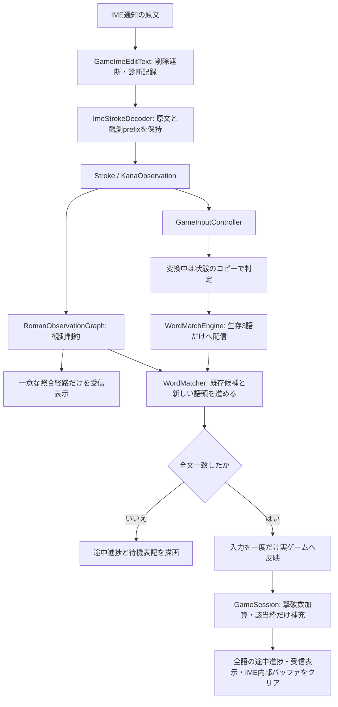

# 入力処理フロー — 承認済みv1の実装結果

2026-10-26、ユーザーの「では、その要件をすべて満たすように実装せよ」で全要件の実装を承認。実際のSimeji通知を採取してから修正した。実打鍵による確認と、通知を再生する自動テストは区別して記録する。

## 実測した入力経路

端末: Pixel 7a / Android 17。IME: com.adamrocker.android.input.simeji/.OpenWnnSimeji。
人が日本語QWERTYで入力した結果を、Decoderより前で記録した。

| 人が入力した綴り | 実際のsetComposingText | 修正後のゲーム受信表示 |
| --- | --- | --- |
| sima | s → し → しm → しま | s → si → sim → sima |
| shima | s → sh → し → しm → しま | s → sh → shi → shim → shima |
| netto | n → ね → ねt → ねっt → ねっと | n → ne → net → nett → netto |

i自体の英字通知は届かなかったが、shのhは届いていた。この差を消さずに保持する。
旧実装は「sに続くし」でも未観測のhを通る経路を許し、既定のshiを選んでいた。
修正では、観測済みprefixに続く仮名化を音節の終端として照合する。未観測の子音を追加する経路は禁止する。
s→しならsiだけ、sh→しならshiだけが成立する。sだけならshiもsiも可能なので既定表示を維持する。

## 原文・判定・表示を分ける

| データ | 内容 | 使用先 |
| --- | --- | --- |
| sourceText | IME通知の原文。し、ねっと等も書き換えない | 診断ログ |
| tokens | 実文字Stroke、仮名変化と観測済みprefixのKanaObservation | 判定 |
| inputText | 一意に確認できた照合経路の表記。一意に決まらない区間は実際の仮名 | ゲームの受信表示 |
| WordMatchState.inputText | 対象語の待機表記。一致履歴と未入力部分の既定表記 | Canvas |

inputTextからStrokeを作って判定へ戻すことは禁止する。仮名から既定のローマ字列を作り、受信したことにする処理も置かない。
音節終端として扱うのは母音1個、長音記号、または実測で確認したn→んの確定遷移。任意の子音やxtuを隠れた入力として認めない。
一意に決まらない多音節の一括置換では、ローマ字の物理打鍵を特定したと主張しない。

## 何をしたらどうなるか

- s: shippaiを保ち、sだけ黄色。hが来ればshippaiのまま。siが英字で届くか、s→しの音節終端を確認した時点でsippaiへ切り替える。
- kanasimi: 入力済みのsiをshiへ変更しない。raw英字の全通知と、IME変化の観測履歴を保持する。
- sha: しゃめんと、途中のhaで始まるはなびの候補を同時に進める。
- netto: ねt→ねっtでは末尾に実在するtを促音の文脈に使う。xtuを追加しない。明示的に入力されたxtuは別表記として認める。
- だいと: 未確定末尾のとがどへ変わる余地があるので、だいの2文字を黄色で保つ。どの通知で3文字へ進む。修飾待ちだけで撃破しない。
- 英字を観測した後の母音・ー: 直前のローマ字方式を維持。明確な仮名入力は仮名方式へ切り替える。
- Enter: 未確定入力を一度だけ反映してIME内部を空にする。ゲームの過去の受信履歴を消す操作にはしない。
- 全文一致: Enter前でも即撃破。その枠の語を補充し、カウンターと入力クリアを同期する。
- 削除: deleteSurroundingText、コードポイント版、DEL/FORWARD_DEL、選択範囲置換、切り取りを入口で遮断する。

## 検証と残る境界

- 実測通知: [修正前](verification/ime-human-japanese.jsonl)、[修正後](verification/ime-human-fixed-r2.jsonl)。
- 修正後の実打鍵では、simaとshimaを別表記で保持し、nettoの5文字が黄色になった。
- 続けてnoを実打鍵すると、ねっとのがEnterなしで撃破された。ログ92のねっとの通知に対し94でreceived=;count=1となり、その後の空通知でも1のまま。
- [実打鍵の入力画面](verification/typing-human-fixed-r2.png)、[即撃破の画面](verification/typing-human-defeat-r2.png)。
- 単体テストと端末での通知再生テストは、取得した実測列を回帰ケースに固定した。これら自体は物理打鍵試験ではない。
- 今回の物理確認は上記Simejiのsima/shima/nettoと即撃破。全IME・全配列・全別表記の物理確認はしていない。
- 母音・長音だけでフリックへの切り替えを常に識別できるわけではない。直前方式を使う。
- 仮名だけを一括通知してprefixが全く観測できないIMEでは、失われたsi/shiを復元できない。その場合は実際の仮名を保持し、綴りを決め打ちしない。

詳細なファイル責務は[日本語入力設計](JapaneseInputDesign.md)を参照。
