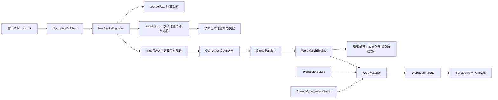

# 日本語入力の観測・照合・表示

状態: 2026-10-26、承認済みフローに沿って実測後に修正。Simeji日本語QWERTYのsima / shima / nettoとEnter不要の撃破を実打鍵ログで確認。

## 責務の分割

| ファイル／クラス | 主な関数 | 責務・データの移動 |
| --- | --- | --- |
| MainActivity | onCreate / createGameInputController | 入力コールバックを接続。Controllerから受信表示・文字数ストリーク・ミス回数を受け、WordMatchStateをSurfaceへ渡す |
| GameImeEditText | onCreateInputConnection / onKeyDown | IME通知をDecoderへ渡す。削除を遮断。一致時・確定時に内部バッファを空にする |
| ImeStrokeDecoder | composing / commit / finish / reset | 未確定区間の差分と観測済みprefixを保持。sourceText原文、tokens、inputTextを返す |
| RomanObservationGraph | edges / advance / accepts / confirmedSpelling | 観測済みprefix＋音節終端という制約を照合。未観測子音を拒否。一意な成立表記だけを表示用に返す |
| GameInputController | onInputTokens / currentWords | 複製上の未確定プレビューと実状態への一度だけの反映。共有入力イベントも返す |
| GameSession | accept / previewInput / snapshot | 生存8語、撃破数、ランダム選出、該当枠だけの補充を所有 |
| WordMatchEngine | accept / previewInput / replaceWord | 全語へ配信し、試行のミス・確定した読み文字数・共有完成を判定。他語の進捗を残し、受信表示は有効な末尾へ整理 |
| WordMatcher | accept / acceptObservation / snapshot / fork | 既存の進捗と各位置からの語頭候補を並行して照合。確かな入力で別表記を決定 |
| TypingLanguage / JapaneseTypingLanguage | romanEdges / observationEdges / canModifyKana | 言語固有の別表記・促音・撥音・修飾規則。現在は日本語だけ登録 |
| WordListRepository | load | 正式表記・読み・言語タグのTSVを読む。辞書全語には判定器を作らない |
| MySurfaceView / WordListCanvasRenderer | showWords / 描画 | 正式表記を灰色、待機文字を黒／黄色、背景を白に描く。判定しない |
| ImeInputTrace | record | Debugで明示的に有効化されたセッションだけ、当アプリの通知とゲーム更新を記録 |
| InputDiagnosticActivity (debugのみ) | createGameInputController | 固定の検証語で通常ゲームと同一のController・UIコールバックを使う |

## 補完と区別する境界

tokensはStroke（実際の文字）とKanaObservation（仮名・観測済み英字prefix・直後に残るprefix）の2種類。
原文sourceTextを書き換えず、仮名変化も観測として保持する。

Simejiの実測ではsiがs→し、shiがs→sh→しとして届く。
観測済みprefixをすべて消費した後に許すのは、仮名化で確定した音節終端の母音1個、長音記号、または実測したn→んの確定遷移だけ。
sからしになったときに、観測していないhを通過することはできない。このためsiだけが成立する。
shの観測があればshiが成立する。

表示用inputTextはその一意な照合経路であり、受信キーイベントの原文とは区別する。
これをStroke列へ変換して判定へ戻さない。一意に決められない区間は実際の仮名を表示する。
不明な一括置換から、既定のローマ字綴りを受信したことにはしない。

## 既定表記と別表記

sではshiもsiも可能なのでshippaiを維持する。短い候補を優先しない。
siの確定後はsippaiへ切り替え、入力済みのsiに後からhを挿入しない。
kanasimi / kanashimi、cha / tya / cya等を入力経路として保持する。
ユーザー指定のtila / tixaをちゃとして扱うゲーム固有別名もある。
wi / weはうぃ / うぇ。uxi / uli / uxe / uleも認める。

ねt→ねっtでは、直後に残る実際のtを文脈に促音の遷移を認める。
xtuを生成せず、観測済みttを重複させない。明示されたxtuは許可する。
全別表記の完成文字列を直積列挙せず、読み位置と綴り途中位置の状態を進める。同じ将来の判定状態は統合する。

## んの位置と入力に応じた表記（2026-10-28）

- 語中で後続音節と混同しない場合はnとnnの両方を受け付ける。hanpatu / hannpatuは、どちらもはんぱつ。
- 省略できるnnは初期表示ではnを使う。hanではhanpatsuを保ち、hannでhannpatsuへ切り替える。つの既定表記tsuと、実入力tuの別表記は従来どおり。
- naはな、nyaはにゃ、honyakuはほにゃく。ほんやくにはhonnyakuを使う。母音・や行などとの境界規則を保つ。
- ローマ字入力の語末のんはnnだけを認める。kanではかんを撃破せず、kannで撃破する。語末のn'・xnも対象外。フリックで直接届くんは通常の1文字の仮名として扱う。
- 規則はJapaneseTypingLanguage.romanEdgesに集約し、待機表記と判定で共有する。表示だけnnに変えて判定をnのままにしない。
- Simeji日本語QWERTYの実測では、はn→はんpが単独n、はn→はん→はんpがnn。前者は後続pで確定し、後者は後続英字なしでんに変化する。この違いをobservationEdgesとisObservationTerminalで共有し、入力済みnを増減させない。
- EnterのcommitTextだけで末尾nがんへ変わっても、新しいnの入力とは扱わず観測済みのnを保持する。ローマ字のんを不明時に仮名入力へすり替えて語末nn制約を回避しない。この確定のみの境界は合成通知の回帰テストで検証。
- かn→かんも実打鍵の2個目のnで発生した通知。語末のkannとして照合し、かnの段階では撃破しない。初回の英語QWERTY通知と再試行の日本語QWERTY通知は別の試行として記録した。

## 未確定プレビュー・修飾・撃破

変換中テキストは判定器のコピー上で評価し、全文一致時だけ実ゲームに一度反映する。
commitText / finishComposingTextでは未反映の入力を一度だけ適用する。
全文一致で撃破数加算と該当枠の補充を行い、ほかの語の途中進捗を残す。IMEの内部バッファはクリアするが、ゲームの受信表示は継続候補が必要とする末尾を残す。ミス・読み文字数ストリーク・複数語完成イベントの詳細は[MistypeDesign.md](MistypeDesign.md)を参照。
Enterだけでは過去のゲーム受信履歴を消さない。文字数上限は設けていない。

未確定末尾だけ、濁点・半濁点・小書き化で次の正解文字へ変わるなら既存prefixを保つ。
だいとでは2文字の黄色を維持し、だいどで3文字に進む。保留だけで撃破しない。
確定済み・語中の誤字は厳密に不一致とする。修飾対応表は言語規則で共有する。

## 入力方式とローカライズ

英字を観測するとローマ字方式。母音・ーだけの通知は直前方式を保つ。
母音・ー以外の仮名が直接来れば仮名方式へ戻す。
IME通知だけでは物理的な方式変更を完全に識別できないため、この推定境界を残す。
言語固有ルールはTypingLanguage、IME観測はImeTextDecoderを境界とし、UIロケールとは独立する。

## 検証の根拠

[承認済みフローと実測表](InputFlowApproval.md)、[検証記録](verification/README.md)を参照。
ユーザーの実打鍵と人工通知再生の成功を混同しない。未知のIMEで正確な物理打鍵を保証しない。
