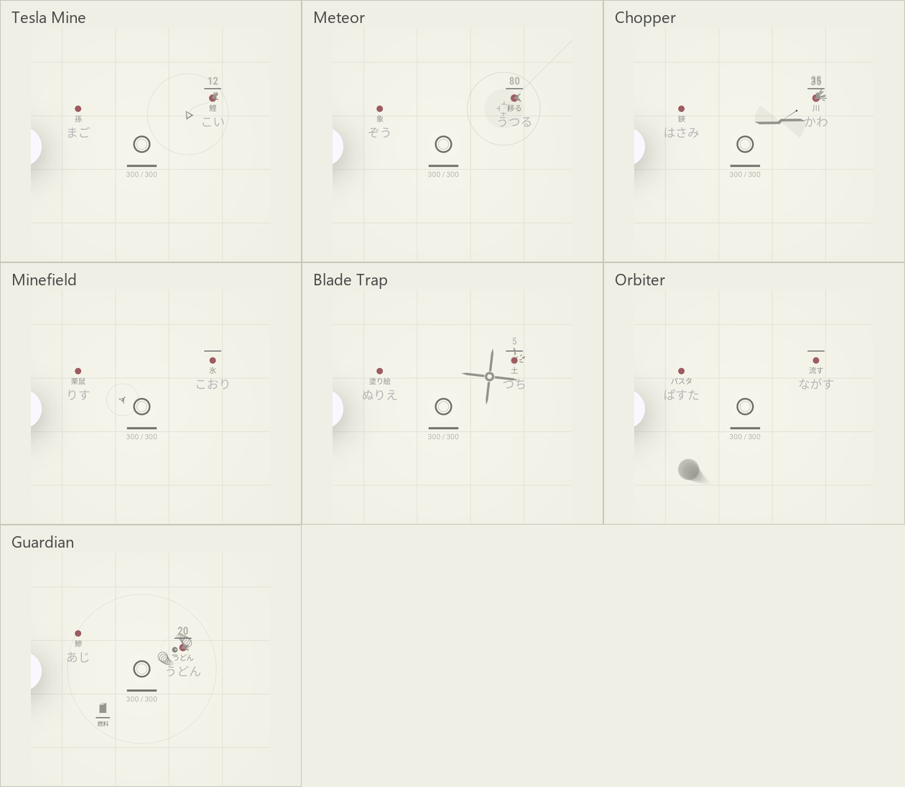

# エリア型武器のサイズを1.5倍へ調整

## 適用範囲

| 武器 | 実効半径・刃長（dp、通常強化前） |
| --- | --- |
| Tesla Mine | 効果半径38 → 57。本体の三角形も1.5倍 |
| Meteor | 爆撃半径40 → 60。照準も1.5倍 |
| Chopper | 刃の半径24 → 36 |
| Minefield | 爆発半径30 → 45。本体・接触判定・範囲円も1.5倍 |
| Blade Trap | 刃長28 → 42。刃の厚みの接触許容も1.5倍 |
| Orbiter | 球の半径10 → 15。公転経路は敵との距離を維持 |
| Guardian | 護衛半径70 → 105。本体・自身の火球軌道・火球も1.5倍 |

`WeaponSizeTuning.AREA_WEAPON_SCALE = 1.5`を描画・シミュレーションの共通設定にした。通常の範囲強化はこの補正後に乗算する。Chopperは拡大した刃が画面外へ抜けるまで残る。

## 確認結果

- Debug APK・AndroidTest APKのビルド成功。
- 単体113件成功。拡大後に届く旧範囲の外側へ実ダメージが入り、新しい範囲より外には当たらないことを確認。
- エミュレーターの`WeaponVisualInstrumentedTest`が成功（51.933秒）。全11種とSpectreの時間差の12画面を保存し、サイズ調整した7種を目視した。[実行ログ](emulator-result.txt)。
- ユーザー指定により、今回のビルド配備・画面確認はエミュレーターで実施。

`emulator/weapon-*.png`は実際のCombatActivityのアプリ領域。比較一覧はエリア型7種を抽出したもの。撮影時のSpectre画面にはAndroidのアクセシビリティツールバーの説明ポップアップが写っているが、ゲームの表示ではなく、変更対象の7種を遮っていない。制御した戦闘状態による描画確認であり、人のIME実打鍵の記録ではない。

正本は[LevelUpDesign.md](../../LevelUpDesign.md)、拡大前の実画面は[前回の外観確認](../weapon-visuals-20261031/README.md)。
