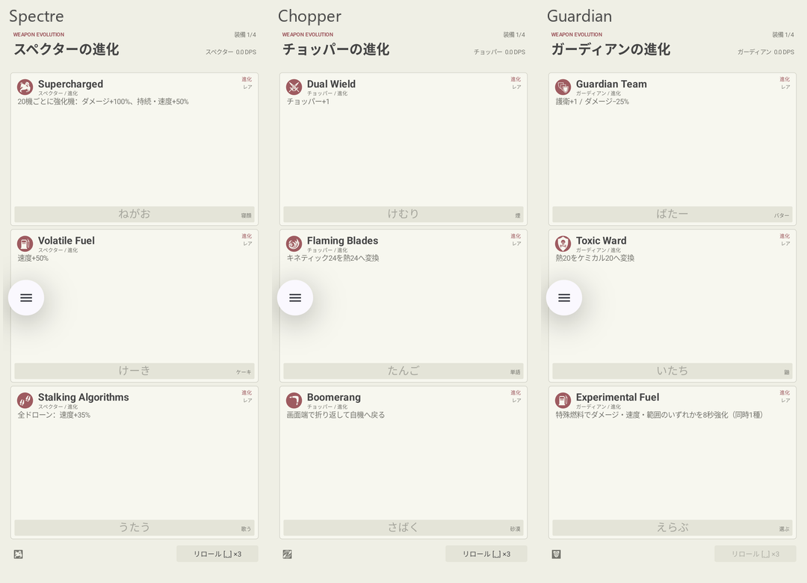
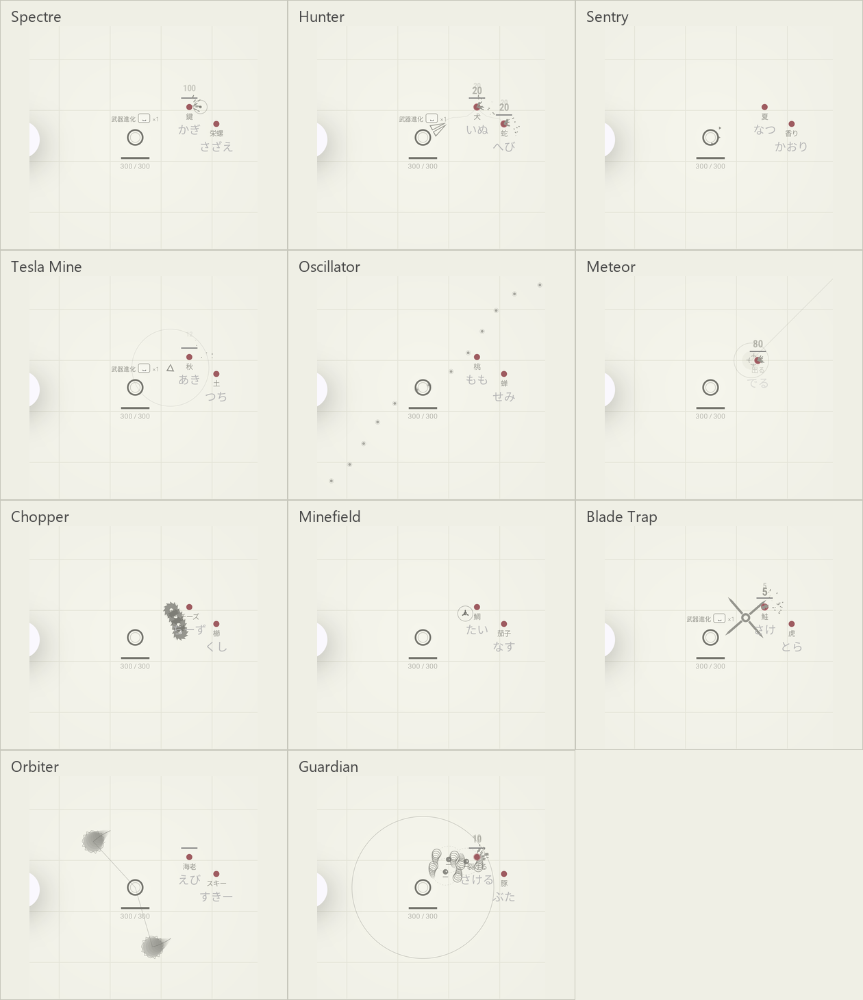

# 撃破進化の検証

2026-10-31 / project/glyphica-android

## 実装と根拠

[進化設計](../../WeaponEvolutionDesign.md)を参照。全12武器の進化カウントを共通化し、累計50・150・300で最大3回選択する。サブ武器は43枝。前提のないEmergency ProtocolとDirty Bombは対象外。通常レベルアップ、保留Space操作、初期3回リロール、エリア型のサイズ1.5倍を維持した。

公式Wiki・日本語Wiki・Steamガイドに加え、公開Webデモの進化条件と描画を照合。通常機から強化機への変化、12歯のノコギリ、Storm RingとTetherを実際の攻撃へ接続した。進化カード43字形と特殊燃料3字形を公式フォントから編集可能なSVGへ変換。

## 実行

端末はユーザー指定の`emulator-5554`。Pixel 7aへはインストール・操作していない。

```powershell
.\gradlew.bat :app:testDebugUnitTest :app:assembleDebug :app:assembleDebugAndroidTest
adb -s emulator-5554 install -r app/build/outputs/apk/debug/app-debug.apk
adb -s emulator-5554 install -r app/build/outputs/apk/androidTest/debug/app-debug-androidTest.apk
adb -s emulator-5554 shell am instrument -w -r -e class jp.ac.ritsumei.ise.phy.exp2.is0842rf.testgame.WeaponEvolutionInstrumentedTest,jp.ac.ritsumei.ise.phy.exp2.is0842rf.testgame.LevelUpInstrumentedTest jp.ac.ritsumei.ise.phy.exp2.is0842rf.testgame.test/androidx.test.runner.AndroidJUnitRunner
```

単体133件成功。進化境界と3回上限、実撃破・状態異常撃破の帰属、全43枝の全ランク取得とシミュレーション、複数武器の報酬保留・停止、同武器リロール、進化カウント強化、既存・後続武器への全体効果、追加文字の共有割り当て、特殊燃料の置き換えと失効、属性変更、貫通、連鎖、折り返し、ノコギリ数、逆回転、テザー、自爆、追尾・自動地雷、状態異常ダメージ、範囲攻撃のCritと照準削除を確認した。

Androidは[6件のログ](instrumentation.txt)と、連続爆撃の移動・冷気ダメージを追加確認した[1件のログ](meteor-instrumentation.txt)を保存。全12武器のカード表示・選択適用、進化後11サブ武器の描画、既存のSpace保留・タップ・合成入力・リロール・燃料の操作を確認。比較用メテオの追加確認は、標的近くに制御配置し、移動とDPS>0を確認するもの。

実Activity/Canvasを撮影した記録で、人によるIME実打鍵の証明ではない。今回のカード画像は縦長のアリーナ領域。小さい表示領域の配置は既存の320×360dp等の単体レイアウト検証も通っている。エミュレーターの`show_ime_with_hard_keyboard`は検証時に1、終了後に元の0へ戻した。

## 画面





`evolutions/choices-*.png`は全12武器の実画面、`evolutions/evolved-*.png`は全11種の攻撃体。`make-contact-sheets.py`は実画面を縮小・切り抜きして一覧へ並べるだけで、画面の代替描画はしない。左端の丸い三本線はAndroid側のオーバーレイで、ゲームUIではない。

## 残る範囲

未実装のシールド／Splatter Shotが前提の2系統は出さない。距離のdp換算や一部間隔は試作値で、Steam最新版との完全一致を示す検証ではない。公式Wikiと公開デモが食い違う箇所は設計書に採用値を明記した。
