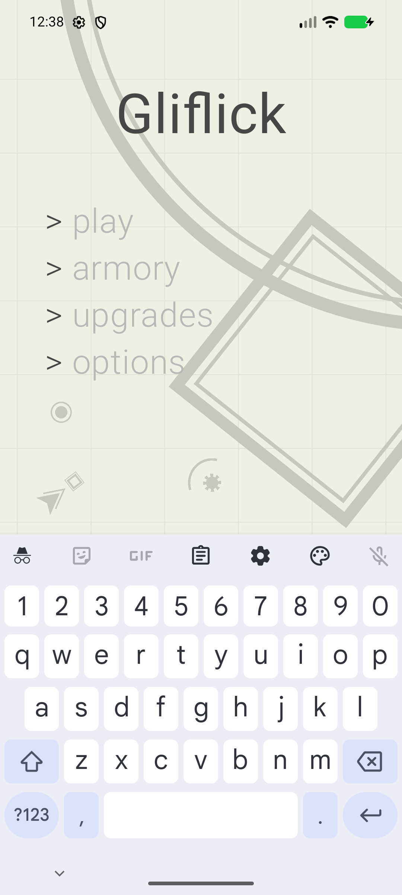

# Gliflickへの改名と公開準備

2026-11-02

## 変更

- Gradleの`rootProject.name`、アプリ表示名、タイトル表記を`Gliflick`へ統一。
- Androidテーマを`Theme.Gliflick`、診断ログのタグを`Gliflick`へ変更。未使用のネイティブテンプレートのCMake名も`gliflick`へ変更。
- 既存インストールへの更新を維持するため、`applicationId`とKotlinのパッケージ名は変更しない。
- 公開向けREADME、第三者資料・字形の参照元、ローカル認証ファイルのignoreを追加。公開AGENTSのマシン固有メモリ接続情報を除去。

## 検証

```powershell
.\gradlew.bat :app:testDebugUnitTest :app:assembleDebug :app:assembleDebugAndroidTest
```

ビルド成功、単体133件成功。APKの`application-label`は`Gliflick`、起動先は従来のTitleActivityであることを`aapt2 dump badging`で確認。

`emulator-5554`で更新インストールし、既存のタイトル画面テスト`normalAndPlCompositionMatchTheFigmaStates`が成功。[実行ログ](instrumentation.txt)を保存した。これは合成入力による回帰で、人のIME打鍵ではない。

AVDがオフラインから復帰しなかったため、ユーザーデータを保持して以前のスナップショットを読み込まず再起動。通常起動後にADBの実スクリーンショットを撮り、タイトル・配置・色を目視確認した。



公開前には、到達可能なGit履歴のテキストとファイル名を確認。秘密鍵、代表的な認証トークン、認証情報付きURL、ローカルSDK設定・鍵ファイルの追跡は検出されなかった。170件の既存コミット履歴は維持し、元から説明が空の2コミットも内容を書き換えない。
