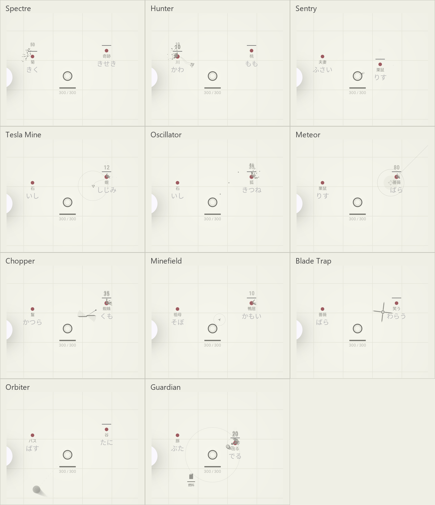

# 全11種の攻撃体とドローン移動の確認



## 結果

- `:app:testDebugUnitTest`：112件成功。`SecondaryWeaponMotionTest`の4件でSpectreの移動・攻撃・接触後の継続飛行、Hunterの移動・先端射撃、Orbiterの起点・公転、Guardianの追跡・火球・燃料停止を確認。
- `:app:assembleDebug :app:assembleDebugAndroidTest`：成功。
- Androidエミュレーターで`WeaponVisualInstrumentedTest`：1件成功、全11種とSpectreの時間差の12画面を保存。GPUへのフレーム反映を待って画面を取得した。
- 同じエミュレーターで`LevelUpInstrumentedTest`：4件成功。Spaceによる選択開始、リロール残数、語入力、進化、複数武器・燃料の描画を再確認。ログは[levelup-regression-result.txt](levelup-regression-result.txt)。
- Pixel 7a：最新版とテストAPKをインストール済み。ADB接続を復旧した時点で再ロックされており、今回の外観確認はエミュレーターで実施。実機の表示確認は未完了。

これらは実際のCombatActivityとCanvasを表示し、制御した戦闘状態を進めた結果。描画モック、SVGだけのプレビュー、人のSimeji実打鍵の記録ではない。エミュレーターのスクリーンショットにはシステムのアクセシビリティボタンが写るが、ゲームの追加UIではない。

## 画像とログ

- `emulator/weapon-*.png`：アプリの戦闘View全体。通常のメニュー用武器アイコンは画面下の装備枠だけにある。
- [Spectre](emulator/weapon-spectre.png) / [その0.5秒後](emulator/weapon-spectre-after.png)：敵まで移動し、その後も違う位置に軌跡を描く。
- [Hunter](emulator/weapon-hunter.png)：細長い三角形と、先端から敵までの折れ線状の電撃。
- [Guardian](emulator/weapon-guardian.png)：自身の周囲を回る輪状火球・残像・破線・燃料バー。
- [全11種の描画確認ログ](emulator-result.txt)。
- `make-contact-sheet.py`：取得済みのアプリ画像から中央領域を切り出して並べる。画像の元になったアプリの撮影処理は`WeaponVisualInstrumentedTest`。

## 再現コマンド

```powershell
.\gradlew.bat :app:testDebugUnitTest :app:assembleDebug :app:assembleDebugAndroidTest
adb -s <device> install -r app/build/outputs/apk/debug/app-debug.apk
adb -s <device> install -r app/build/outputs/apk/androidTest/debug/app-debug-androidTest.apk
adb -s <device> shell am instrument -w -r -e class jp.ac.ritsumei.ise.phy.exp2.is0842rf.testgame.WeaponVisualInstrumentedTest jp.ac.ritsumei.ise.phy.exp2.is0842rf.testgame.test/androidx.test.runner.AndroidJUnitRunner
uv run --with pillow python docs/verification/weapon-visuals-20261031/make-contact-sheet.py emulator
```

図形ごとの公式画像・映像・公開デモの対応は[外観の正本](../../WeaponActorAppearance.md)を参照する。参照用に取得した動画、GIF、デモスクリプトはGit対象外の`build/weapon-references`に置き、製品へ同梱しない。
